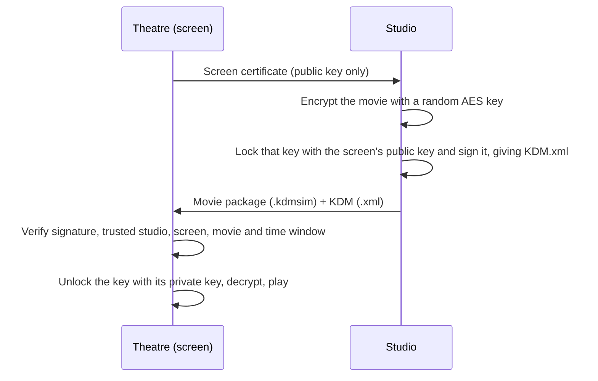

# Key Delivery: a KDM Cinema Simulator

**Encrypt a movie, issue a KDM, and watch it unlock on a screen, all inside your browser.**

Key Delivery simulates how a digital cinema keeps a film locked until the right key arrives, for the right screen, at the right time. It is built with plain HTML, CSS and JavaScript. There is nothing to install, no server and no dependencies. The cryptography is real and comes from the browser's built-in Web Crypto API.

<!-- Add a screenshot or GIF of the screening room here:

-->


---

## What is a KDM?

In digital cinema, a film is delivered as a **DCP** (Digital Cinema Package) whose picture and sound are encrypted. The package alone is useless. To play it, the cinema needs a **KDM** (Key Delivery Message), a small XML file from the studio that contains:

- the film's decryption key, locked so that **only one specific screen** can open it,
- the **time window** in which the key is valid,
- the studio's **digital signature**, so the theatre can tell it is genuine and untampered.

This project recreates that whole flow so you can see and touch every step.

## How it works



The app has three tabs, one for each side of the workflow:

| Tab | What you do |
|---|---|
| **Theatre** | Create a screen certificate. Its private key stays inside the browser and cannot be exported. Manage the list of trusted studios. |
| **Studio** | Pick an MP4 or WebM file and encrypt it into a `.kdmsim` package. Issue a KDM locked to a screen certificate, with a validity window. |
| **Screening room** | Load the package and the KDM. The server runs its pre-show checks, and if they all pass, the curtains open and the film plays. |

## Features

- **Real encryption:** AES-128-GCM for the movie, RSA-OAEP (2048-bit) to lock the key to a screen, and ECDSA P-256 for the studio's signature.
- **A KDM you can read:** a human-readable XML file with the same building blocks as a real KDM (validity window, recipient thumbprint, composition ID, encrypted key, signature).
- **Tamper detection:** change one character of the KDM, or one bit of the movie, and it is rejected.
- **Device binding:** a KDM made for one screen will not open on another.
- **Time-limited keys:** the key is released only inside its validity window, and the screen purges it and stops playback when the window ends.
- **Pre-show checklist:** every check is shown with a plain-language reason when it fails.
- **Runs offline:** one HTML file. Your movie never leaves your computer.

## Quick start

### Run it locally

1. Download or clone this repository.
2. Open `index.html` in a current **Chrome, Edge or Firefox**.

That's it. Nothing to build.

## Walkthrough

1. **Theatre tab:** click **Create certificate**.
2. **Studio tab, Pack a movie:** choose any MP4 or WebM, click **Encrypt movie**, then **Download package**.
3. **Studio tab, Issue a KDM:** choose the movie, click **Use this browser's screen**, pick a validity window, then click **Issue KDM** and **Download KDM**.
4. **Screening room:** load the `.kdmsim` package and the KDM `.xml`, then click **Start screening**. The first time, click **Trust** when the theatre asks whether to trust the studio.

## Try breaking it

The most interesting part is watching the checks fail:

- Use the **Already expired** or **Starts tomorrow** presets and try to screen.
- Open the KDM in a text editor, change the end date, and load it. The signature check fails.
- Create a second certificate (Theatre tab, **Replace**) and try a KDM that was issued for the first one.
- Issue a 1-minute window and keep watching. When it ends, the curtains close and the key is purged.

## Tech

| Piece | Used for |
|---|---|
| Web Crypto API | AES-GCM, RSA-OAEP, ECDSA, SHA-256 |
| IndexedDB | Storing non-extractable private keys in the browser |
| `DOMParser` | Reading the KDM XML |
| `Blob` and object URLs | Encrypting and decrypting the movie in 1 MB blocks, then playing it |
| CSS | The curtain animation and theatre styling |

## How this maps to a real cinema

| In this project | In a real digital cinema |
|---|---|
| Movie package (`.kdmsim`) | The DCP: picture and sound files encrypted with AES-128 |
| Screen certificate | The public certificate of the cinema server's media block |
| KDM (`.xml`) | SMPTE KDM: the content key encrypted with the server's public key and signed by the studio |
| Valid from / until | `ContentKeysNotValidBefore` / `ContentKeysNotValidAfter` |
| Stop and lock | The server purging the key when the window closes |

## Limitations

This is a **learning tool**, not a compliant DCI/SMPTE implementation and not copy protection.

- There is no certificate authority chain. The theatre uses a trusted-studios list instead.
- The movie uses AES-128-GCM in 1 MB blocks, not AES-CBC inside MXF files.
- There is one content key for the whole film, and the signature is a simplified version of XMLDSig.
- Once a film is decrypted in your browser's memory, a determined person could capture it.
- Keys live in the browser that created them. Clearing site data or switching browsers means starting again.
- The whole movie is held in memory while encrypting and playing, so use clips under about 500 MB.
- Playback depends on your browser's codecs. MP4 (H.264/AAC) and WebM work best.

## Project structure

```
kdm-cinema-simulator/
├── index.html      # the entire app (HTML + CSS + JS)
├── README.md
```

## Ideas for next steps

- A built-in demo film generator, so no video file is needed
- An X.509-style certificate chain with a root authority
- Per-reel keys and multiple movies in one KDM
- Streaming decryption with Media Source Extensions for large files

## License

Released under the MIT License.
Copying and Reusing is Strictly Warned and will be blocked in usuage.

Built by Aravindh D.
